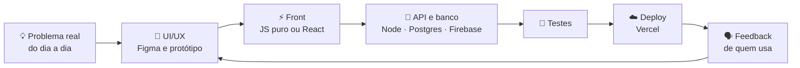

**Dev Full Stack e suporte de TI. Faço apps web que o pessoal usa de verdade no dia a dia:**
**minigames pro escritório, PDV de cafeteria, ferramentas de suporte e gestão de clínica.**

 

 

## 📑 Sumário

- [✨ Em poucas linhas](#-em-poucas-linhas)
- [🚀 Projetos em destaque](#-projetos-em-destaque)
- [🔭 No forno agora](#-no-forno-agora)
- [🧭 Como eu construo](#-como-eu-construo)
- [🛠️ Tech stack](#️-tech-stack)
- [📊 Números do GitHub](#-números-do-github)
- [📬 Bora conversar](#-bora-conversar)

 

## ✨ Em poucas linhas

| | |
| --- | --- |
| 🎨 **UI/UX em primeiro lugar** | Design systems, glassmorphism, cards 3D e microinterações. Se é pra usar todo dia, tem que ser gostoso de usar. |
| 🧱 **Full stack de ponta a ponta** | Do front em JS puro ou React até API em Node, banco (Postgres, SQLite, Firebase) e deploy na Vercel. |
| 🤖 **IA no fluxo de trabalho** | Gemini, Claude e Ollama tanto pra construir mais rápido quanto dentro dos próprios apps. |
| 🛎️ **Visão de suporte** | Trabalho no suporte de TI, então sei onde o usuário trava. Isso vira decisão de produto. |
| 📚 **Sempre aprendendo** | TypeScript, GraphQL e SQL avançado no momento. |

 

## 🚀 Projetos em destaque

### 🎮 [MicroGames](https://github.com/PainN04/MicroGames) &nbsp;·&nbsp; [jogar online ↗](https://microgames-ten.vercel.app)

> **27 minigames de navegador pra jogar com o pessoal do trabalho.** Ranking compartilhado, desafio do dia, torneio semanal, duelos, duplas e 43 conquistas.

 

| O que tem | Como fiz |
| --- | --- |
| 🕹️ **27 jogos**: reflexo, cabeça e arcade (Termo, Sudoku, 2048, Cobrinha, Come-Come, Ritmo…) | Um arquivo JS por jogo. Phaser só baixa quando alguém abre um jogo que precisa dele. |
| 🏅 **Ranking anti-trapaça** | O servidor confere faixas válidas e tem trava anti-autoclicker antes de gravar. |
| 📅 **Desafio do dia + torneio semanal** | Sorteio determinístico compartilhado entre cliente e servidor, então os dois sempre concordam. |
| 🚦 **Integração com o Geiko** | Quem está com a fila de tickets cheia fica sem jogar até resolver alguns. Regra editável no painel admin. |
| 🧪 **Mesmo código no PC e na produção** | Um único `router.js`; só o banco muda (SQLite local, Neon na Vercel). |

&nbsp;

 

### ☕ [PDV Grão e Fubá](https://github.com/PainN04/Gr-o-Fub-)

> **Ponto de venda web pra uma cafeteria de verdade**, feito pra rodar no tablet do balcão, até sem internet.

| | |
| --- | --- |
| 🧾 **Venda rápida** | Catálogo por categoria, tamanhos e adicionais, comanda com quantidade e desconto (R$ ou %). |
| 💳 **4 formas de pagamento** | PIX, cartão, dinheiro com troco automático e divisão da conta entre várias pessoas. |
| 🖨️ **Cupom térmico 80mm** | Impressão direto do navegador, com senha do pedido em destaque. |
| 💾 **Comandas salvas** | Fica tudo no aparelho e dá pra retomar depois. |
| 🎨 **Design system próprio** | Paleta café/caramelo, Playfair Display + Montserrat, layout que se adapta a desktop, tablet e celular. |

 

## 🔭 No forno agora

<table>
<tr>
<td width="50%" valign="top">

### 🛎️ Geiko Workspaces
Ferramenta de suporte N1 com **React + Firebase** e interface em glassmorphism. É dela que vem a integração de fila de tickets usada no MicroGames.

</td>
<td width="50%" valign="top">

### 🧘 Agenda Fisio
Sistema de gestão pra **estúdios de fisioterapia e pilates**: agenda, pacientes e o dia a dia do estúdio num lugar só.

</td>
</tr>
</table>

 

## 🧭 Como eu construo

Começo sempre por quem vai usar. Ajudo no suporte, então muita ideia nasce de ver alguém travando numa tela. Depois desenho, construo, testo e ponho no ar rápido pra ouvir o pessoal e melhorar.

 

## 🛠️ Tech stack

| Área | Ferramentas |
| :---: | :---: |
| 💻 **Linguagens** |  |
| ⚡ **Frontend** |  |
| 🎨 **Design** |  |
| 🔧 **Backend e banco** |  |
| ☁️ **Deploy e ferramentas** |  |
| 🤖 **IA e LLMs** |    |

<b>📚 Estudando agora</b>

 

| Tema | Por quê |
| --- | --- |
| **TypeScript** | Tipagem forte no front pra projetos que crescem (como o MicroGames). |
| **GraphQL** | Buscar só o que a tela precisa. |
| **SQL avançado** | Dominar a camada de dados: índices, window functions e consultas de relatório. |
| **IA em produção** | Integrar LLMs nos apps com custo e latência sob controle. |

 

## 📊 Números do GitHub

  
  

  

  <picture>
    <source media="(prefers-color-scheme: dark)" srcset="https://raw.githubusercontent.com/PainN04/PainN04/output/github-snake-dark.svg" />
    <source media="(prefers-color-scheme: light)" srcset="https://raw.githubusercontent.com/PainN04/PainN04/output/github-snake.svg" />
    
  </picture>

 

## 📬 Bora conversar

Topo projeto open source, SaaS com UX caprichado e integração criativa com IA.
Pode me chamar pra falar de **React, Node, Firebase, design systems ou APIs de IA**.

 

  

Feito com café, Figma e alguns minigames no intervalo. ☕🎮

